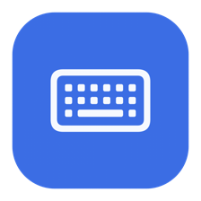
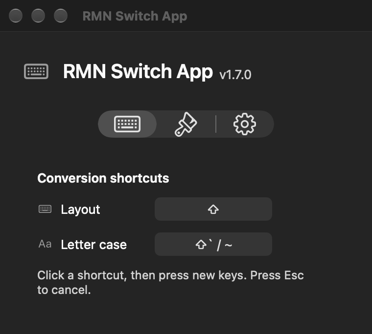
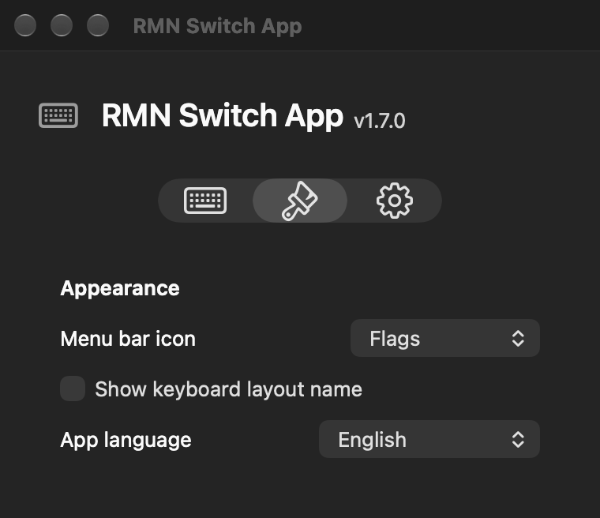

<p align="center">
  
</p>

<h1 align="center">RMN Switch App</h1>

<p align="center">A small macOS menu bar app that fixes text typed with the wrong Russian or English keyboard layout.</p>

<p align="center">
  <a href="README.md">English</a> · <a href="README.ru.md">Русский</a>
</p>

<p align="center">
  <a href="https://github.com/ekb-rmn/RMN-Switch-App/releases/latest"></a>
  
  
</p>

<p align="center">
  <a href="https://github.com/ekb-rmn/RMN-Switch-App/releases/latest"><strong>Download for macOS →</strong></a>
</p>

## Fix a typo with one tap

Typed `ghbdtn` instead of `привет`? Tap **Shift** to convert the last word, or select text and convert the whole selection. Switch can also change letter case.

| Action | Default shortcut |
| --- | --- |
| Convert Russian ↔ English keyboard layout | Shift, tapped on its own |
| Change letter case | Shift + ` / ~ |

You can assign your own shortcuts in Settings. Conversion swaps supported Russian and English letters in both directions, including already correct text in a mixed selection.

## A compact app, in your language

English and Russian are included. Switch follows your macOS language by default; choose **System Default**, **Русский** or **English** in **Appearance → App language**. Changes apply immediately.

| Shortcuts | Appearance & language |
| :---: | :---: |
|  |  |

## Install

1. Open the [latest release](https://github.com/ekb-rmn/RMN-Switch-App/releases/latest) and download **RMN-Switch-App-1.7.0-Universal.zip** under **Assets**.
2. Unzip it and move **RMN Switch App.app** to **Applications**.
3. Open the app and grant **Accessibility** access in macOS System Settings so it can convert text in other apps.
4. Optionally enable **Launch at login** in Switch settings.

Requires **macOS 12 Monterey or later**, on Intel or Apple Silicon. The app uses a local signature and is not notarized by Apple. If macOS blocks it, and you trust this source, use **Open Anyway** in **Privacy & Security**.

## Privacy & behavior

- No network requests, analytics, input history or automatic updates.
- Only the last word, up to 256 characters, is temporarily kept in memory. It is cleared when you switch apps, click or move the cursor.
- macOS Secure Input is respected. Shortcut and language preferences stay on your Mac.
- Text replacement uses the clipboard and restores its previous contents if you have not changed them. Some custom editors and terminals may behave differently.
- Switch hides the macOS input indicator while running and restores it on normal quit.

## Build from source

On a Mac with the Xcode developer tools installed:

```sh
cd "RMN Switch App Xcode"
./build.sh
```

The script builds both architectures, applies a local signature and runs the built-in tests. The resulting **RMN Switch App.app** is created in the repository root. You can also open the included Xcode project.

[Подробная документация на русском](RMN%20Switch%20App%20Xcode/README.md)
