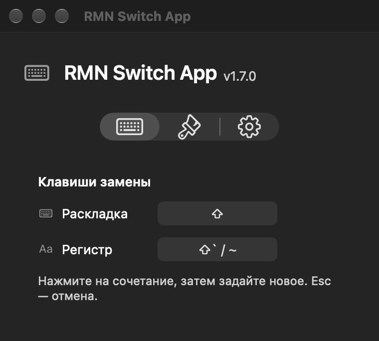
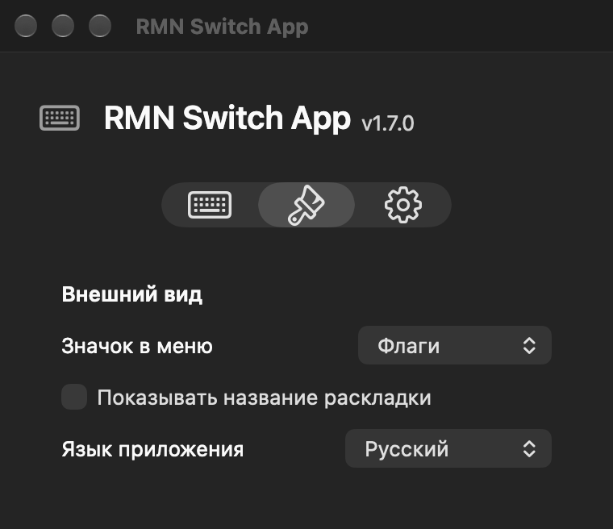

<p align="center">
  
</p>

<h1 align="center">RMN Switch App</h1>

<p align="center">Небольшое приложение в строке меню macOS для исправления текста, набранного в неверной русской или английской раскладке.</p>

<p align="center">
  <a href="README.md">English</a> · <a href="README.ru.md">Русский</a>
</p>

<p align="center">
  <a href="https://github.com/ekb-rmn/RMN-Switch-App/releases/latest"></a>
  
  
</p>

<p align="center">
  <a href="https://github.com/ekb-rmn/RMN-Switch-App/releases/latest"><strong>Скачать для macOS →</strong></a>
</p>

## Исправьте раскладку одним нажатием

Набрали `ghbdtn` вместо `привет`? Коротко нажмите **Shift**, чтобы исправить последнее слово, или выделите текст, чтобы преобразовать всё выделение. Switch также умеет менять регистр букв.

| Действие | Клавиши по умолчанию |
| --- | --- |
| Замена русской ↔ английской раскладки | Shift отдельно, короткое нажатие |
| Смена регистра | Shift + ` / ~ |

Сочетания можно переназначить в настройках. В смешанном выделении поддерживаемые русские и английские буквы меняются в обе стороны, включая уже правильно набранный текст.

## Компактное приложение на вашем языке

Доступны русский и английский. По умолчанию Switch использует язык macOS. Во вкладке **«Внешний вид» → «Язык приложения»** можно выбрать **«Как в macOS»**, **«Русский»** или **English**. Перевод применяется сразу.

| Клавиши | Внешний вид и язык |
| :---: | :---: |
|  |  |

## Установка

1. Откройте [последнюю версию](https://github.com/ekb-rmn/RMN-Switch-App/releases/latest) и скачайте **RMN-Switch-App-1.7.0-Universal.zip** в разделе **Assets**.
2. Распакуйте архив и перенесите **RMN Switch App.app** в **«Программы»**.
3. Откройте приложение и разрешите **«Универсальный доступ»** в настройках macOS, чтобы Switch мог менять текст в других приложениях.
4. При желании включите **«Запускать при входе в систему»** в настройках Switch.

Нужна **macOS 12 Monterey или новее**, Intel или Apple Silicon. Приложение использует локальную подпись и не нотарифицировано Apple. Если macOS блокирует запуск и вы доверяете источнику, используйте **«Всё равно открыть»** в разделе **«Конфиденциальность и безопасность»**.

## Конфиденциальность и особенности

- Нет сетевых запросов, аналитики, истории ввода и автоматических обновлений.
- Только последнее слово длиной до 256 символов временно хранится в памяти. Оно очищается при переключении приложения, клике или перемещении курсора.
- Защищённый ввод macOS не обрабатывается. Язык интерфейса и настройки клавиш сохраняются на вашем Mac.
- Для замены используется буфер обмена; прежнее содержимое восстанавливается, если вы его не изменили. В нестандартных редакторах и терминалах поведение может отличаться.
- Пока Switch работает, системный индикатор раскладки скрыт. При обычном выходе его видимость восстанавливается.

## Сборка из исходников

На Mac с установленными инструментами разработчика Xcode:

```sh
cd "RMN Switch App Xcode"
./build.sh
```

Скрипт собирает обе архитектуры, подписывает приложение локальной подписью и запускает встроенные проверки. Готовое **RMN Switch App.app** появляется в корне репозитория. Также можно открыть входящий в проект файл Xcode.

[Подробная документация](RMN%20Switch%20App%20Xcode/README.md)
